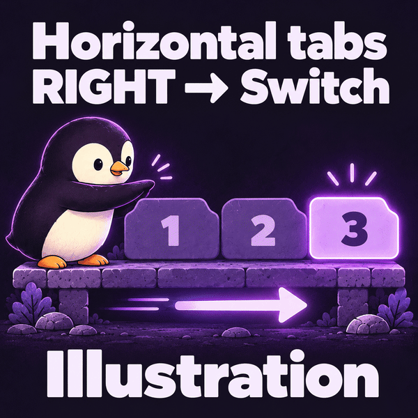

<picture>
  <source media="(max-width: 600px) and (prefers-color-scheme: dark)" srcset="docs/assets/banner-themes/air-traffic-mobile-dark.png">
  <source media="(max-width: 600px) and (prefers-color-scheme: light)" srcset="docs/assets/banner-themes/air-traffic-mobile-light.png">
  <source media="(prefers-color-scheme: dark)" srcset="docs/assets/push-my-tabs-air-traffic.png">
  <source media="(prefers-color-scheme: light)" srcset="docs/assets/banner-themes/air-traffic-light.png">
  
</picture>

English · [Deutsch](docs/readme/README.de.md) · [简体中文](docs/readme/README.zh-CN.md) · [日本語](docs/readme/README.ja.md) · [Español](docs/readme/README.es.md) · [한국어](docs/readme/README.ko.md) · [Português (Brasil)](docs/readme/README.pt-BR.md) · [Français](docs/readme/README.fr.md)

# Push My Tabs

<p align="center"><strong>Switch and move tabs the way they appear.</strong><br>Layout-aware keyboard shortcuts and quick tab actions for Chrome and Firefox.</p>

<p align="center"><a href="https://chromewebstore.google.com/detail/bagfcickffpfkgecknaepmfleikeojik"><strong>Install for Chrome ↗</strong></a> · <a href="https://addons.mozilla.org/firefox/addon/push-my-tabs/"><strong>Install for Firefox ↗</strong></a> · <a href="https://pengusto.github.io/push-my-tabs/">Website</a></p>

<p align="center">Chrome 127+ · Firefox 142+</p>

## Find your flow

For keyboard-first browsing with horizontal or vertical tabs.

Horizontal tabs? Switch left and right. Vertical tabs? Switch up and down.
The adaptive preset maps the four direction commands to your tab layout, so switching and moving tabs stay easy to understand.



[View the static illustration](docs/assets/penguin/tabs-demo-poster.png).

*Function illustration of the adaptive preset, not a screen recording. Direction labels refer to extension commands; assign your preferred keyboard shortcuts in your browser.*

| With horizontal tabs | With vertical tabs |
| :--- | :--- |
| **Left / Right** → switch tabs | **Up / Down** → switch tabs |
| **Up / Down** → move the active tab | **Left / Right** → move the active tab |

## Small actions. Fewer interruptions.

- **Navigate by direction.** Switch tabs or move the active tab with the adaptive preset.
- **TabLoop.** Switch across windows in last-used order, forward or backward. Assign the normal cycle shortcut first; quick cycling is optional.
- **Keep quick actions close.** Duplicate, pin, mute, jump to the first or last tab, or move a tab to a new window.
- **Make it yours.** Choose your layout and shortcut assignments. Keep optional commands out of the way until you need them.

<p align="center"></p>

## Get started

1. Install from the Chrome Web Store or Firefox Add-ons using the links above.
2. Open **Navigation** to see the four direction actions and their current assignments. The sidebar also contains **TabLoop**, **Layout**, **Shortcut bindings**, and **Settings**.
3. Open **Shortcut bindings** to edit assignments directly in Firefox or open Chrome’s shortcut editor. Actual bindings use Mac symbols or Windows/Linux labels automatically.
4. Set or adjust your shortcuts in your browser. Start with the adaptive preset; choose a manual layout if automatic detection does not match your setup.

The popup distinguishes **Natively detected**, **Automatically estimated**, and **Manually set** layouts. Chrome estimates from window geometry; an open side panel can affect the result. Firefox 142+ reads its vertical-tabs setting directly. Zen uses its own tab bar, so its inherited Firefox setting is ignored: confirm the estimated layout or choose a manual layout. Saved confirmations are shown as manually set.

## Your tabs stay yours

No accounts, analytics, advertising, or remote code. Settings stay in your browser.
Chrome uses temporary `activeTab` access after a shortcut or popup action for local layout profiles. Firefox uses `storage` and `browserSettings` without reading page data.

[Privacy](PRIVACY.md) · [Support](https://github.com/pengusto/push-my-tabs/issues) · [Releases](https://github.com/pengusto/push-my-tabs/releases) · [Changelog](CHANGELOG.md)

<details>
<summary><strong>Languages, development, testing & release details</strong></summary>

## Current status

Chrome and Firefox release packages share the same tested source. Firefox 142 or newer uses the browser's exact vertical-tabs setting and lets users edit supported command shortcuts directly in the settings page.

The popup and full settings page share the same five views. Navigation offers the four direction actions and additional tab/window commands. TabLoop cycles through recently used open tabs without a browsing-history list. Layout manages automatic/manual orientation and saved confirmations. Shortcut bindings contains all commands, presets, and custom mappings. Settings contains language, wrapping, close behavior, and private-window access.

## Languages

Chrome and Firefox automatically select the extension language from the browser UI locale. The settings page also offers a manual language override. Push My Tabs includes English, German, Spanish, French, Brazilian Portuguese, Italian, Polish, Turkish, Japanese, Simplified Chinese, Arabic, Russian, Ukrainian, Kurdish (Kurmanji), and Dari Persian. Unsupported browser locales fall back to English.

## Local Chrome test

From the repository root, with Node.js 22, `zip`, and `unzip` available (no package-install step):

```sh
./scripts/build-chrome-dev.sh
```

1. Open `chrome://extensions`.
2. Enable **Developer mode**.
3. Choose **Load unpacked** and select `dist/chrome-dev`.
4. Confirm the four direction shortcuts, then assign any optional shortcut you want at `chrome://extensions/shortcuts`.
5. To use the extension in Incognito, open its details and enable **Allow in Incognito**. The popup explains this when the setting is missing. `⌘T` remains Chrome's native new-tab shortcut; use the assigned new-tab command (recommended: `⌥T`) for tab placement.

## Checks

```sh
node tests/layout.test.mjs
node tests/api.test.mjs
node tests/background.test.mjs
node tests/firefox.test.mjs
node tests/i18n.test.mjs
node tests/ui.test.mjs
node tests/ui-flow.test.mjs
node tests/shortcuts.test.mjs
jq empty manifests/chrome.json manifests/firefox.json
```

## Chrome release

Node.js 22, `zip`, and `unzip` are required. From a clean checkout, one command runs all checks and creates `dist/push-my-tabs-chrome-<version>.zip`:

```sh
./scripts/build-chrome.sh
```

For a permanently loaded development copy, select `dist/chrome-dev` once in
`chrome://extensions` and refresh it after running `./scripts/build-chrome-dev.sh`.

## Firefox release

Firefox 142 or newer, Node.js 22, `npx`, `zip`, and `unzip` are required. The build runs pinned Mozilla `web-ext` lint. The Firefox package requests only `storage` and `browserSettings`; it declares that no data is collected or transmitted.

```sh
./scripts/build-firefox.sh
```

## Automated release

Run **Actions → Create release** on `main`, enter the next tag (for example `v1.3.0`), and leave store submission enabled. The workflow prepares versions and changelog, runs checks, builds both ZIPs, creates a GitHub release, and submits the same packages to Chrome and Firefox after a one-time account connection. A prepared `v*` tag also triggers the workflow. Ordinary source pushes only run CI.

Chrome uses API v2 and short-lived Google tokens; Firefox uses Mozilla's pinned client. Store reviews remain asynchronous. Missing access or rejected submissions stop explicitly. See [release setup and recovery](docs/releasing.md) and the [store media plan](docs/store-media.md).

Tagged releases and their matching Chrome and Firefox archives are available on the [GitHub Releases page](https://github.com/pengusto/push-my-tabs/releases).

See [CONTRIBUTING.md](CONTRIBUTING.md) to work on Push My Tabs and [SECURITY.md](SECURITY.md) to report a vulnerability privately.

The extension uses no host permissions, content scripts, accounts, analytics, advertising, or remote code. Chrome's `activeTab` permission temporarily exposes only the current tab after a shortcut or popup action, allowing local geometry profiles for its origin or exact path. Firefox does not request that permission or read page data.

</details>

## Brand assets

[Logo kit and usage guide](docs/branding/README.md): SVG logos, app icons, favicons, and the purple Push P identity.

## License

[MIT](LICENSE). See [asset provenance](docs/assets/README.md) for the README illustrations.
