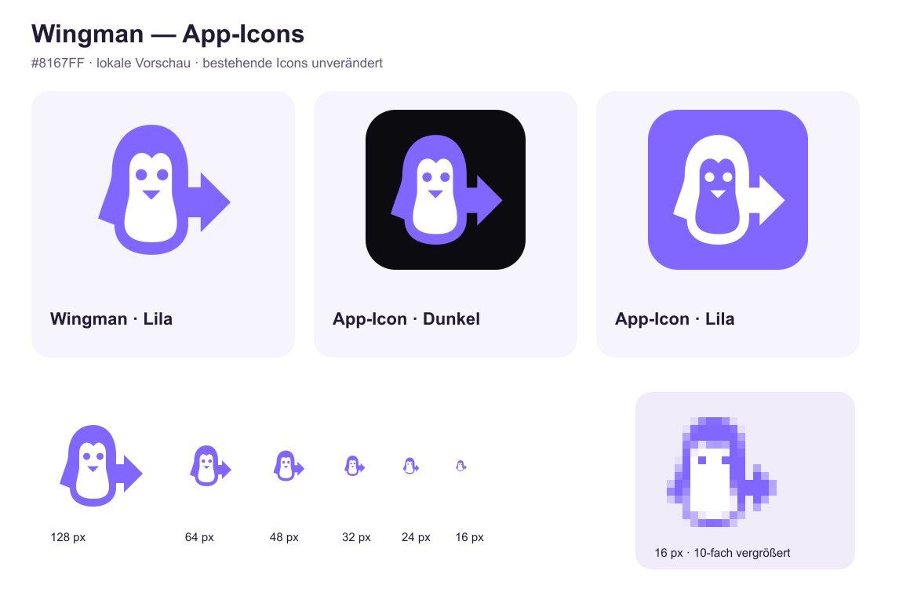

# Wingman extension app icon

Approved dark variant of concept B: a purple penguin whose right wing is a
direction arrow. Purple `#8167FF`, dark tile `#0B0B10`, white face `#FFFFFF`.
Geometric SVG artwork constructed for this project; no fonts, external images,
filters or generated raster illustration inside the mark.

## Sources and deployed sizes

- `wingman-app-dark.svg`: regular dark tile, copied to `src/assets/icons/logo.svg`.
- `app-dark-1024.png`: reviewed render, used for extension PNGs at 32/48/128/1024 px.
- `wingman-app-small.svg`: independent 16 px drawing on the dark tile.
- `app-dark-small-16.png`: reviewed native 16 px render, copied without resampling.
- `wingman-small-16.svg`: tiny symbol without tile; no beak, larger pixel-aligned eyes.
- `wingman-purple.svg`: colour symbol; its white face is deliberately opaque.
- `wingman-black.svg` / `wingman-white.svg`: single-colour symbols with real holes.

The preview also shows a purple tile for comparison; only the **dark** app icon
is deployed. Keep the arrow pointing right, preserve aspect ratio and the tile's
padding. Use the small cut at 16 px; do not shrink the full facial detail into it.
The extension's existing manifest and UI paths remain unchanged. Website headers
and footers also use the dark tile. The SVG favicon uses the small drawing;
the ICO preserves separate 16/32/48 px frames, including the native small cut.
Touch and web icons use the regular tile. The maskable icon has a fully opaque
dark background and a smaller inset to keep the mark inside its safe circle.

## Rebuild and retention

With Pillow installed, run `python3 docs/branding/wingman/export-icons.py` from
any directory. The script checks render dimensions before generating PNGs and
copies the reviewed SVG, and updates website icons and their `digital/` copies.
To change the geometry, render the regular SVG at exactly
1024 × 1024 and the small SVG at exactly 16 × 16 into the named master PNGs first.
Inspect both sizes before exporting. The older `docs/branding/export-icons.py`
also delegates all deployed icon exports here while retaining historical Push P
artwork exports. Its older `source/` files are not the deployed Wingman masters.

The old extension SVG and PNGs are retained under `../previous-push-p/extension/`.
`../previous-push-p/SHA256.json` records their original hashes. Keep this archive
for rollback; the earlier directional-key identity is also retained separately.
The old website icons are retained under `../previous-push-p/website/` with hashes
in the same JSON file. Existing Push P sources and presentation artwork remain.

Regression lesson: a detailed face becomes crowded at 16 px. Preserve the separate
small drawing through every export route rather than resizing the regular mark.
Local rendering and packaging checks do not imply installation or store approval.
No store upload, release tag or trademark clearance is part of this integration.

## Website integration checks

The local homepage was visually reviewed at measured 390 and 1440 CSS pixels;
320 px was also checked for horizontal overflow. Header and footer logos loaded
at their intended 38 px size. English/German privacy and legal-notice pages were
checked at 320 px with no horizontal overflow. PNG dimensions, old-asset hashes,
the native 16 px ICO frame and all foreground pixels within the maskable safe
circle were verified. Keep individual ICO frames: resizing one large frame would
lose the separate tiny drawing. The maskable export places a 288 px tile inside
a 512 px opaque canvas, including antialiased tile edges within the safe circle.
