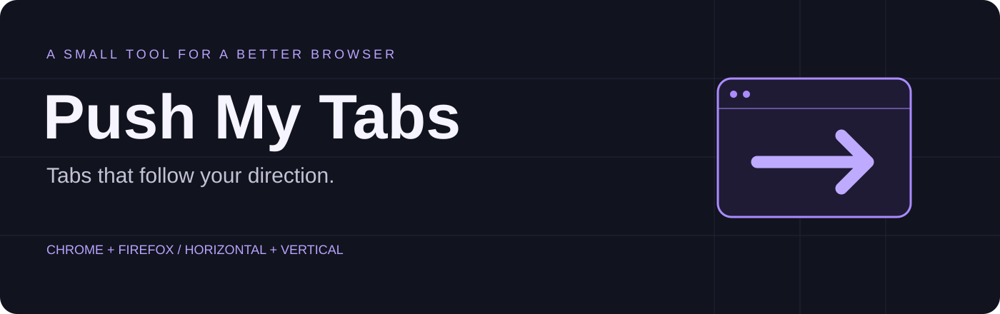
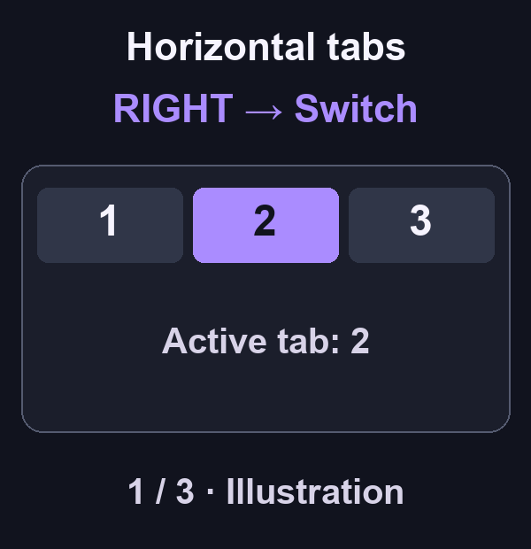

[English](../../README.md) · [Deutsch](README.de.md) · [简体中文](README.zh-CN.md) · [日本語](README.ja.md) · [Español](README.es.md) · [한국어](README.ko.md) · [Português (Brasil)](README.pt-BR.md) · Français

> Cette traduction a été produite avec une assistance automatique et n’a pas encore été relue par une personne francophone. En cas de différence, le [README anglais](../../README.md) fait foi.

# Push My Tabs

**Changez et déplacez les onglets selon leur disposition.**

Pour naviguer au clavier avec des onglets horizontaux ou verticaux.

## Installation

- [Chrome Web Store](https://chromewebstore.google.com/detail/bagfcickffpfkgecknaepmfleikeojik) pour Chrome 127 ou version ultérieure
- [Firefox Add-ons](https://addons.mozilla.org/firefox/addon/push-my-tabs/) pour Firefox 142 ou version ultérieure

[Site web](https://pengusto.github.io/push-my-tabs/)

## Trouvez votre rythme



*Illustration du préréglage adaptatif, pas une capture vidéo. L’image contient du texte anglais ; les directions désignent les commandes de l’extension. Attribuez vos raccourcis dans le navigateur.*

[Illustration statique](../assets/tabs-demo-poster.png)

| Onglets horizontaux | Onglets verticaux |
| :--- | :--- |
| **Gauche / Droite** → Changer d’onglet | **Haut / Bas** → Changer d’onglet |
| **Haut / Bas** → Déplacer l’onglet actif | **Gauche / Droite** → Déplacer l’onglet actif |

Actions rapides : dupliquer, épingler, couper le son, aller au premier ou dernier onglet ou déplacer un onglet dans une nouvelle fenêtre. La disposition, le préréglage et les raccourcis facultatifs sont configurables.

<p align="center"></p>

## Premiers pas

1. Installez l’extension avec l’un des liens vers les boutiques ci-dessus.
2. Ouvrez le panneau pour voir les quatre commandes directionnelles et leurs raccourcis actuels.
3. Réglez les raccourcis dans le navigateur. Commencez par le préréglage adaptatif et choisissez une disposition manuelle au besoin.

Chrome estime la disposition selon la géométrie de la fenêtre ; un panneau latéral ouvert peut perturber la détection. Firefox 142+ lit directement son réglage des onglets verticaux.

## Vos onglets restent chez vous

Sans compte, analyse, publicité ni code distant. Les réglages restent dans le navigateur. Chrome utilise un accès temporaire `activeTab` pour les profils locaux ; Firefox utilise `storage` et `browserSettings` sans lire les données des pages.

[Confidentialité](../../PRIVACY.md) · [Assistance](https://github.com/pengusto/push-my-tabs/issues) · [Versions](https://github.com/pengusto/push-my-tabs/releases) · [Journal des modifications](../../CHANGELOG.md)

<details>
<summary><strong>Langues, développement et versions</strong></summary>

## État actuel

Les paquets Chrome et Firefox utilisent le même code testé. Firefox 142 ou version ultérieure lit le réglage exact des onglets verticaux et permet de modifier les raccourcis pris en charge depuis les paramètres.

La fenêtre contextuelle et les paramètres affichent les quatre raccourcis directionnels avec leurs affectations actuelles. Les raccourcis facultatifs restent dans une section repliée. La fenêtre contextuelle permet aussi d’atteindre le premier ou le dernier onglet, puis de déplacer, dupliquer, épingler ou couper le son de l’onglet actuel, ou de l’envoyer dans une nouvelle fenêtre.

## Langues

Chrome et Firefox choisissent automatiquement la langue selon l’interface du navigateur. Vous pouvez aussi la choisir dans les paramètres. Push My Tabs comprend l’anglais, l’allemand, l’espagnol, le français, le portugais brésilien, l’italien, le polonais, le turc, le japonais, le chinois simplifié, l’arabe, le russe, l’ukrainien, le kurde kurmandji et le dari. Les langues non prises en charge utilisent l’anglais.

## Test local dans Chrome

Créez d’abord la copie de développement non empaquetée :

Depuis la racine du dépôt, il faut Node.js 22, `zip` et `unzip`. Aucune installation de paquets n’est nécessaire.

```sh
./scripts/build-chrome-dev.sh
```

1. Ouvrez `chrome://extensions` et activez le **Mode développeur**.
2. Choisissez **Charger l’extension non empaquetée**, puis `dist/chrome-dev`.
3. Vérifiez les quatre raccourcis directionnels et attribuez les raccourcis facultatifs dans `chrome://extensions/shortcuts`.
4. Pour le mode navigation privée, ouvrez les détails et activez **Autoriser en navigation privée**. `⌘T` reste le raccourci natif de Chrome pour un nouvel onglet ; utilisez la commande attribuée (recommandation : `⌥T`) pour le positionner.

## Vérifications

```sh
node tests/layout.test.mjs
node tests/api.test.mjs
node tests/background.test.mjs
node tests/firefox.test.mjs
node tests/i18n.test.mjs
node tests/ui.test.mjs
jq empty manifests/chrome.json manifests/firefox.json
```

## Versions Chrome et Firefox

Chrome nécessite Node.js 22, `zip` et `unzip`. Firefox nécessite aussi `npx` et Firefox 142 ou version ultérieure. Le paquet Firefox exécute une version fixée de Mozilla `web-ext` et ne demande que `storage` et `browserSettings` ; aucune donnée n’est collectée ou transmise.

```sh
./scripts/build-chrome.sh
./scripts/build-firefox.sh
```

Pour une copie de développement Chrome chargée en permanence, sélectionnez `dist/chrome-dev` une fois, puis actualisez-la après `./scripts/build-chrome-dev.sh`.

## Publication GitHub manuelle

Dans le workflow **Create release** de GitHub Actions, choisissez la branche ou le commit exact et saisissez une balise correspondant aux deux manifestes, par exemple `v1.2.0`. Le workflow construit les deux paquets et joint les ZIP à une seule publication. La publication sur Chrome Web Store et Firefox Add-ons reste une étape manuelle séparée.

Les versions balisées se trouvent sur [GitHub Releases](https://github.com/pengusto/push-my-tabs/releases). Consultez [CONTRIBUTING.md](../../CONTRIBUTING.md) pour contribuer et [SECURITY.md](../../SECURITY.md) pour signaler une vulnérabilité en privé.

L’extension n’utilise aucune autorisation d’hôte, aucun script de contenu, compte, outil d’analyse, publicité ou code distant. L’autorisation `activeTab` de Chrome n’expose temporairement que l’onglet actuel après un raccourci ou une action contextuelle afin d’appliquer des profils géométriques locaux à son origine ou à son chemin exact. Firefox ne demande pas cette autorisation et ne lit pas les données de la page.

</details>

## Licence

[MIT](../../LICENSE) · [Origine des illustrations](../assets/README.md)
